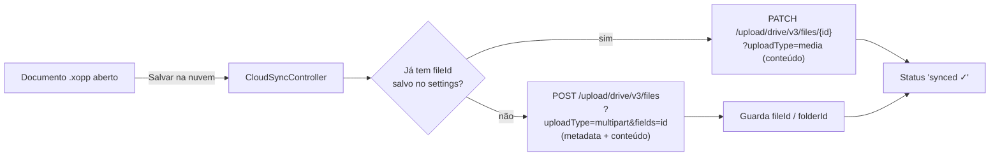

#  Ournal++ Drive Sync

**Fork do [Xournal++](https://github.com/xournalpp/xournalpp) com sincronização nativa no Google Drive — Versão [v1.0](#v10)**

*Ournal++ Drive Sync* é um fork próprio do [Xournal++](https://xournalpp.github.io), software de anotação à
mão escrito em C++ (GTK3), adicionando a ele um módulo completo de sincronização com o Google Drive,
integrado direto ao app — sem ferramentas externas.

<p align="center">
  
</p>

---

## ✨ O que este fork adiciona

A branch [`feature/drive-sync`](https://github.com/MarcosBarros42/xournalpp/tree/feature/drive-sync) traz:

| Funcionalidade | Descrição |
| --- | --- |
| 🔐 **Login OAuth 2.0** | Autenticação com conta Google pelo próprio app (app instalado / loopback redirect) |
| ♻️ **Renovação automática de token** | `refresh_token` renovado e salvo nas configurações, com expiração gerenciada |
| ☁️ **Sincronização no Drive** | Sobe o `.xopp` para uma pasta do Drive (criando ou atualizando o arquivo) |
| 🖥️ **Painel integrado nas Preferências** | Status da conexão, botões de Login / Atualizar / Sincronizar / Logout |
| 📁 **Escopo mínimo** | Usa apenas `drive.file` — o app só enxerga os arquivos que ele mesmo criou |

### Primeiro uso: configurando as credenciais

1. No [Google Cloud Console](https://console.cloud.google.com/apis/credentials), crie um projeto e um
   **ID do cliente OAuth 2.0** do tipo **App para computador**, com a **Google Drive API** ativada.
2. Crie o arquivo `cloudclient.json` na pasta de configurações do app
   (no Windows: `%LOCALAPPDATA%\xournalpp\cloudclient.json`); o caminho correto aparece na tela de
   Preferências → Cloud.
3. Preencha no formato:

   ```json
   {
     "project": "meu-projeto",
     "created": "2026-10-21",
     "type": "authorized_user_desktop_installed_app",
     "client_id": "1234567890-xxxx.apps.googleusercontent.com",
     "client_secret": "GOCSPX-xxxxxxxxxxxx",
     "oauth_scope": "https://www.googleapis.com/auth/drive.file",
     "redirect_flow": "http://127.0.0.1 ephemeral port (installed-app loopback flow)"
   }
   ```

4. Ativo o app → **Preferências → Cloud → Login com Google Drive** → pronto: enquanto o app
   estiver conectado, qualquer documento aberto sincroniza ao clicar em **Sincronizar agora**.

> 💡 Segurança: o `client_secret` nunca deve ser publicado. Se ele vazar, redefina o secret no
> Console e atualize o `cloudclient.json`.

---

## 🧩 Apresentação do código (por dentro do módulo do Drive)

O módulo de nuvem é compacto (≈1.300 linhas): fica em
`src/core/control/cloud/`, com o painel de interface em `src/core/gui/dialog/DriveSettingsPanel.*`
e o layout GTK+ em `ui/cloudSettings.glade`.

| Arquivo | Papel |
| --- | --- |
| [`CloudSyncController.h/.cpp`](src/core/control/cloud/CloudSyncController.cpp) | Cérebro do módulo. **OAuth**: abre o browser para consentimento, recebe o `code` no redirect `http://127.0.0.1` (porta efêmera), troca por tokens e faz `refresh` automático. **Sync**: descobre se o arquivo já está no Drive pela camada de config (`fileIds`) e escolhe entre criar (upload multipart) ou atualizar (PATCH de conteúdo). **Rede**: `httpCall()` genérico sobre libcurl, com cabeçalho Bearer e `CURLOPT_CAINFO` apontado para `cacert.pem` — resolve o certificado ao lado do exe no Windows |
| [`CloudJobs.h/.cpp`](src/core/control/cloud/CloudJobs.cpp) | Trabalhos em *background* (threads do próprio `Job` do Xournal++), para **não travar a interface** durante login e sincronização: `CloudLoginJob` (login + estado "conectado") e `DriveUploadJob` (upload + mensagens de status/erro) |
| [`DriveSettingsPanel.*`](src/core/gui/dialog/DriveSettingsPanel.cpp) | Painel **Preferências → Cloud**: estado da conexão, login, "Sincronizar agora", logout |
| [`ui/cloudSettings.glade`](ui/cloudSettings.glade) | Layout GTK Builder do painel acima |

### Fluxo do sync passo a passo



### Escolhas técnicas importantes

- **Escopo mínimo**: `drive.file` — o app só acessa os arquivos criados por ele mesmo, nada mais da conta
- **Instalação portátil**: o `cacert.pem` fica junto do exe e `package.sh` copia automaticamente no build (sem depender do ambiente MSYS2 no runtime)
- **`PATCH` em vez de `PUT`**: o endpoint de atualização de conteúdo do Drive v3 aceita `PATCH` de forma consistente; descobrimos na prática que `PUT` retorna 404 nesse endpoint
- **Erros amistosos**: falhas HTTP (como 404/401 do Google) aparecem na UI com a mensagem do servidor, para diagnóstico fácil

---

## 🚀 Versão v1.0

Primeira versão estável da sincronização. O que está pronto:

- ✍️ Criação de arquivo novo no Drive (upload multipart) na pasta do usuário fixada no app
- 🔀 Atualização de conteúdo de arquivo já existente (`PATCH .../upload/drive/v3/files/{id}?uploadType=media`)
- 🔑 Login OAuth completo com renovação automática de access token
- 🧰 `windows-setup/package.sh` monta pasta **dist autocontida** para Windows (DLLs do MSYS2,
  loaders GTK, ícones, traduções e **bundle de CA** para o curl funcionar fora do ambiente de desenvolvimento)
- 🐞 Correções feitas durante a v1.0:
  - URL de update duplicava `files/` (`.../drive/v3/files/files/{id}`)
  - `PUT` não é aceito pelo endpoint de update do Drive → trocado por `PATCH`
  - Bundle de certificados CA agora é resolvido a partir da pasta do próprio exe (`cacert.pem`)

---

## 🔨 Compilar no Windows (MSYS2 UCRT64 ambiente)

```bash
pacman -S mingw-w64-ucrt-x86_64-toolchain \
          mingw-w64-ucrt-x86_64-cmake \
          mingw-w64-ucrt-x86_64-ninja \
          mingw-w64-ucrt-x86_64-gtk3 \
          mingw-w64-ucrt-x86_64-json-glib \
          mingw-w64-ucrt-x86_64-curl \
          mingw-w64-ucrt-x86_64-poppler \
          mingw-w64-ucrt-x86_64-portaudio \
          mingw-w64-ucrt-x86_64-gtksourceview4
```

```bash
cmake -S . -B build -DCMAKE_BUILD_TYPE=RelWithDebInfo -GNinja
cmake --build build
bash windows-setup/package.sh build   # gera build/dist (pasta portátil completa); a etapa de instalador NSIS é opcional
```

Para outros sistemas, veja as instruções do upstream
([Linux](readme/LinuxBuild.md), [Windows](readme/WindowsBuild.md), [macOS](readme/MacBuild.md)).

---

## 📚 Créditos

Projeto base: [Xournal++](https://github.com/xournalpp/xournalpp) — um excelente software livre de
anotação à mão (GPLv2). Este fork mantém os créditos e a licença originais, e adiciona o módulo de
nuvem (`src/core/control/cloud/`, `src/core/gui/dialog/DriveSettingsPanel.*`, `ui/cloudSettings.glade`).
